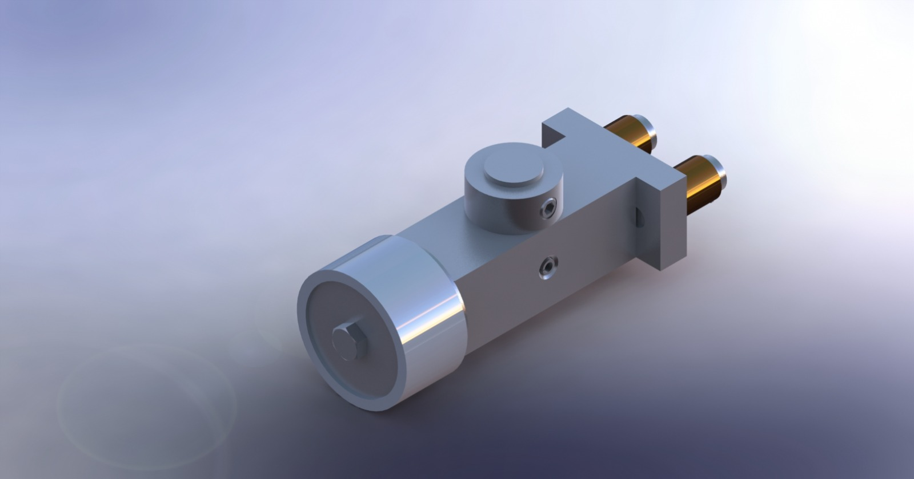
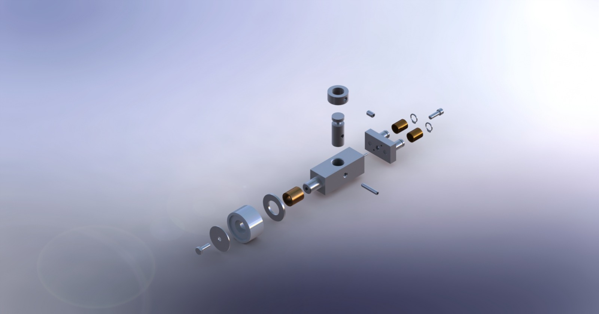
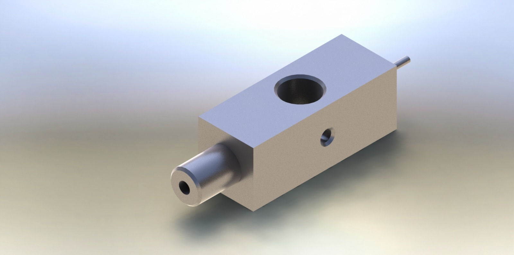
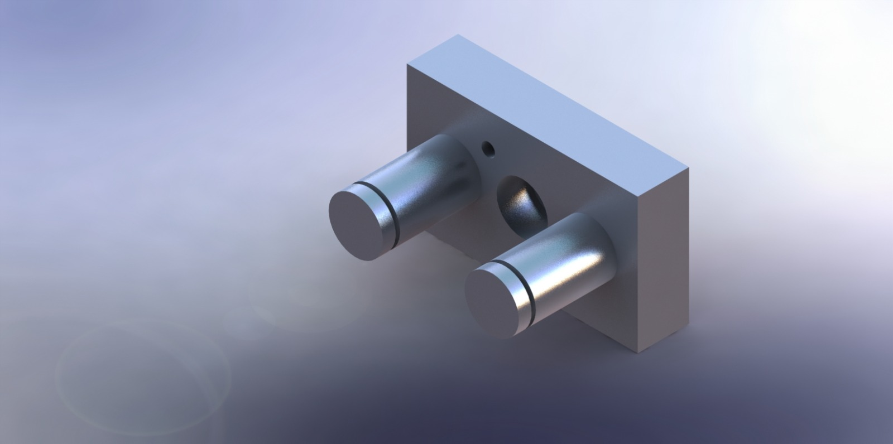

# Bar Support for a High-Speed Filling Line

Academic CAD project completed in 2025 for *Medios de Representación Gráfica II* at the National University of Lomas de Zamora, Argentina.

## Overview

The project focused on 3D mechanical modeling and technical documentation for a bar support assembly intended for a high-speed filling line. The work included modeling parts from technical references, designing a missing component, assembling the mechanism, and preparing construction drawings.

## Project Gallery

### Assembly

### Exploded View

### Designed Missing Component

### Main Body

### Rear Support

## Technical Drawings

PDF drawings are provided so the documentation can be viewed without SolidWorks:

- [Assembly drawing (PDF)](drawings/05TT-5-PD-Conjunto.pdf)
- [Retention washer (PDF)](drawings/05TT-5-PL-035.ArandelaDeRetencion.pdf)
- [Spacer washer (PDF)](drawings/05TT-5-PL-036-ArandelaSeparadora.pdf)
- [Bushing (PDF)](drawings/05TT-5-PL-037-Buje.pdf)
- [Main body (PDF)](drawings/05TT-5-PL-039-CuerpoPrincipal.pdf)
- [Brake (PDF)](drawings/05TT-5-PL-040-Freno.pdf)
- [Part LR0009 (PDF)](drawings/05TT-5-PL-041-LR0009.pdf)
- [Part LR0047 (PDF)](drawings/05TT-5-PL-042-LR0047.pdf)
- [Rear support (PDF)](drawings/05TT-5-PL-043-SoporteTrasero.pdf)
- [Designed missing part (PDF)](drawings/05TT-5-PL-PiezaFaltante.pdf)

## CAD Files

- Native SolidWorks part files (.SLDPRT) and the assembly (.SLDASM) are available in the models/ directory.
- Editable SolidWorks drawings (.SLDDRW) are available in editable-drawings/.

Keep the model files together with their referenced components when opening the assembly, so SolidWorks can resolve the component links.

## Tools

- SolidWorks

## Project Information

- **Type:** Academic group project
- **Course:** Medios de Representación Gráfica II
- **Year:** 2025

This repository presents university coursework and should not be interpreted as a commercial or industrial implementation. The repository currently includes images, CAD files, and PDF drawings; assembly/disassembly videos are not included yet.
